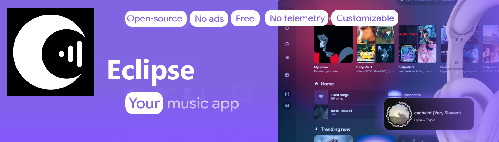

<p align="center">
  
</p>

<h1 align="center">Eclipse</h1>

<p align="center">
  Open-source mobile music player for YouTube Music, SoundCloud, and local audio files.<br>
  Built with React Native and Expo for Android and iOS. No ads, no telemetry, no account required.
</p>

<p align="center">
  <a href="https://github.com/valzevox/eclipse-mobile/releases">
    
  </a>
  &nbsp;
  <a href="https://eclipse-player.vercel.app">
    
  </a>
</p>

## Overview

Eclipse streams from YouTube Music, YouTube, and SoundCloud alongside local audio files (`FLAC`, `WAV`, `MP3`, `M4A`, `OGG`). All playlists, cached audio, and listening history stay on the device.

## Core features

- Direct streaming from YouTube Music, YouTube, and SoundCloud with two-track ahead stream URL prefetching and a 3-hour in-memory cache.
- Word-by-word and line-synced lyrics from LRCLIB, NetEase (YRC), KuGou, Musixmatch, and ZingMP3. Includes automatic CJK romanization, multi-language translation, right-to-left script alignment, and manual timing offset controls.
- Real-time playback rate and pitch adjustments (`Nightcore`, `Slowed`), loop region trimming, EBU R128 loudness normalization, and SponsorBlock segment skipping.
- Playlist migration from Spotify, YouTube Music, Apple Music, NetEase, and Yandex Music.
- Distributed and smart shuffle modes that spread tracks by the same artist across the queue.
- Offline track caching, local file picker, sleep timer with volume fade-out, and Last.fm / Discord webhook presence.
- In-app release checker that downloads and installs new `Eclipse-vX.Y.Z.apk` builds directly from GitHub Releases.

## Project structure

```
app/                  Expo Router screens ((tabs), player, playlist/[id])
src/components/       MiniPlayer, LyricsView, AudioFxModal, UpdateModal
src/services/         Innertube, SoundCloud, lyrics, SponsorBlock, offlineCache, autoUpdate, libraryTools, shapes
src/plugins/          betterShuffle (Spotify-style & smart shuffle)
src/store/            Zustand player store with AsyncStorage persistence
assets/               App icons, splash screen, and 19 SVG cover art shapes
docs/                 Landing, privacy, and terms pages
test/                 Automated parity and unit test suite
```

## Build from source

Requires Node.js 20 or newer.

```bash
git clone https://github.com/valzevox/eclipse-mobile.git
cd eclipse-mobile
npm install --legacy-peer-deps
npm test
npm run typecheck
npx expo start
```

## License

[MIT](LICENSE)
